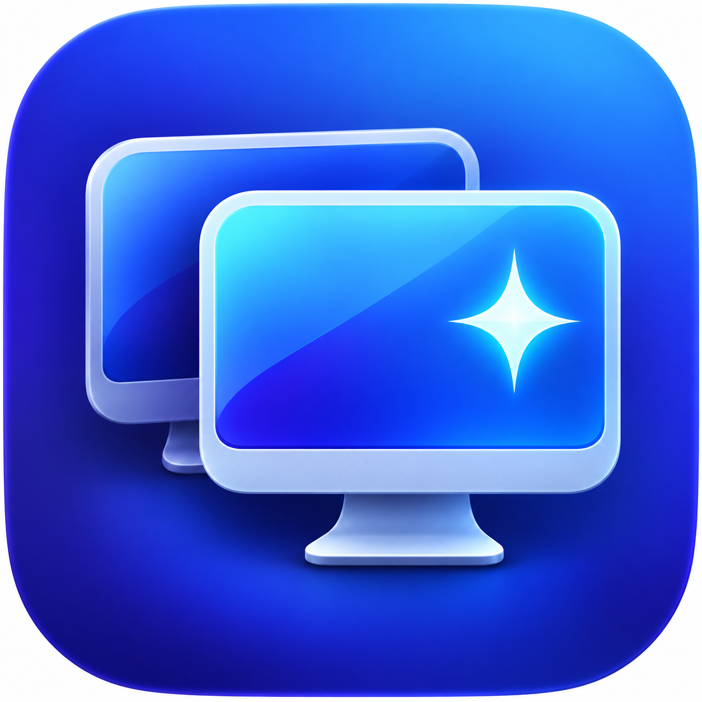

# Retina Dummy

Retina Dummy 是一个轻量的 macOS 菜单栏工具，主要用于将 Mac mini 作为无头服务器远程使用时创建 HiDPI 虚拟屏幕。即使没有连接实体显示器，远程桌面也能获得清晰、可调的 Retina 分辨率，无需额外购买或插入 HDMI 显示器诱骗器（Dummy Plug）。它同样适合其他无头 Mac 和录屏场景。



> **普通用户可直接安装：**前往 [GitHub Releases](https://github.com/TC023456-sys/RetinaDummy/releases/latest) 下载 `Retina-Dummy.zip`，解压后将 `Retina Dummy.app` 拖入“应用程序”即可。无需安装 Xcode；下方“本地构建”仅供开发者使用。

## 适用场景

- 将 Mac mini 作为家庭服务器、开发服务器或远程工作主机
- 无实体显示器连接时，为远程桌面提供稳定的虚拟屏幕
- 替代 HDMI 显示器诱骗器（Dummy Plug），减少额外硬件和接口占用
- 为远程控制、串流和录屏提供清晰的 HiDPI 分辨率

## 功能

- 菜单使用精确的“宽 × 高”数值，不使用含糊的“2K/3K”命名
- 1280×720 至 3840×2160 的常用 HiDPI 预设
- 3440×1440 超宽屏 HiDPI 预设
- 自定义 HiDPI 分辨率，支持 640×480 至 5120×4320 逻辑尺寸
- iPad mini、iPad/Air 11″、iPad Pro 11″、iPad Air 13″ 和 iPad Pro 13″ 横屏 HiDPI 预设
- 所有预设均使用 2× Retina 渲染
- 可同时创建 1–3 个虚拟显示器
- 菜单栏快速开关和模式切换
- 选择真实显示器，镜像到虚拟屏幕使用当前 HiDPI 设置
- 一键恢复原来的镜像设置
- 30、60、75、90、120、144 和 165Hz 刷新率选择
- 可选登录时自动启动
- 显示功能本地运行；手动检查更新时连接 GitHub
- 菜单栏“检查更新…”检测新版并打开官方安装包下载
- “自动检查更新（每天一次）”默认开启，可在菜单关闭；无更新或网络错误时保持安静，同一新版仅自动提醒一次，且只识别 Retina Dummy 发布

## 兼容性

- macOS 13.0 或更高版本
- 主要面向 Apple Silicon Mac

> [!WARNING]
> 本应用使用 macOS 非公开 CoreGraphics 虚拟显示器接口。它不适合 Mac App Store，且 macOS 更新后可能需要适配。

4K、超宽屏或同时启用多个显示器会明显增加 GPU 与统一内存占用。

## 安装

1. 从 Releases 下载最新的 DMG 或 ZIP。
2. 将 `Retina Dummy.app` 拖入“应用程序”。
3. 首次启动后，在菜单栏选择需要的分辨率。

由于当前公开构建使用 ad-hoc 签名且尚未经过 Apple 公证，macOS 可能提示无法验证开发者。你可以在“系统设置 → 隐私与安全性”中确认来源后打开。不要从非本项目 Releases 的第三方链接下载。

## 卸载

1. 在菜单栏取消“登录时自动启动”。
2. 退出 Retina Dummy。
3. 将应用移到废纸篓。
4. 可选：删除 `~/Library/Preferences/local.liang.RetinaDummy.plist` 以清除设置。

## 本地构建

需要 Xcode Command Line Tools。

```sh
chmod +x build.sh scripts/release.sh
./build.sh
```

默认使用 ad-hoc 签名，适合本机测试。正式分发时：

```sh
SIGNING_IDENTITY="Developer ID Application: Your Name (TEAMID)" ./build.sh
```

## 签名、DMG 和 Apple 公证

```sh
SIGNING_IDENTITY="Developer ID Application: Your Name (TEAMID)" \
NOTARY_PROFILE="retina-dummy-notary" \
./scripts/release.sh
```

`NOTARY_PROFILE` 是使用 `xcrun notarytool store-credentials` 预先保存的钥匙串配置名。未设置时，脚本只生成 DMG，不会提交公证。

## 隐私和许可

详见 [PRIVACY.md](PRIVACY.md) 和 [MIT License](LICENSE)。

## 技术说明与致谢

虚拟显示器实现基于 macOS 非公开的 `CGVirtualDisplay` 类族。开发与兼容性调试参考了 [BetterDummy](https://github.com/waydabber/BetterDummy) 和 [hidpi-mirror](https://github.com/pasky/hidpi-mirror) 等开源项目的公开技术资料。

## 真实显示器高清缩放

1. 在菜单栏的“HiDPI 设置…”中选择所需逻辑分辨率，建议与真实屏幕保持相同比例。
2. 打开“真实显示器高清缩放”，选择已连接的显示器。
3. 点击“使用当前 HiDPI 设置”，确认开启。
4. 可选择“恢复原来的镜像设置”退出；关闭虚拟屏幕、切换虚拟屏幕设置或退出应用时也会先恢复镜像。

该功能通过虚拟屏幕镜像实现，不修改显示器物理分辨率。更改 HiDPI 设置后需重新为真实屏幕开启。实际画质与系统镜像模式、屏幕分辨率和宽高比有关。

真实显示器菜单显示当前连接可用模式的最高刷新率，并提供当前分辨率与刷新率。最高值是所有系统可用模式的最大值，不代表所有分辨率均支持该值；显示器未报告固定刷新率时显示未知。

## 实体显示器亮度（v0.8.4）

点击菜单栏图标，主菜单顶部直接显示每台实体外接屏的亮度滑块和「重新读取」。先读取实际亮度，支持时启用 0–100% 滑块；松开滑块后调节，并读回显示器确认。点击「重新读取」同步显示器实体按键改过的亮度。镜像模式仍选取实体显示器，而不是 Retina Dummy 虚拟屏。

当前实现面向 Apple 芯片 Mac 的 DDC/CI 兼容外接屏，不需要 BetterDisplay，不要求屏幕录制权限。Intel Mac 暂不支持此功能。显示器、HDMI/USB-C/DisplayPort 连接及转接设备必须支持 DDC/CI；未响应时界面会明确提示并禁用滑块，不会自动改用软件调暗。当前 ARZOPA 接 Apple M4 HDMI 直连的读取测试失败，不能宣称此屏已支持调节；请检查实体菜单的 DDC/CI 开关、连接和型号兼容性。

硬件通信使用 [waydabber/m1ddc](https://github.com/waydabber/m1ddc) 的 MIT 许可代码，署名和许可证见 `ThirdParty/m1ddc/`，应用也附带许可证。后台通信有超时限制；断连后会校验显示器标识，避免写入另一台屏幕。应用启动和退出不会自动改变硬件亮度。
